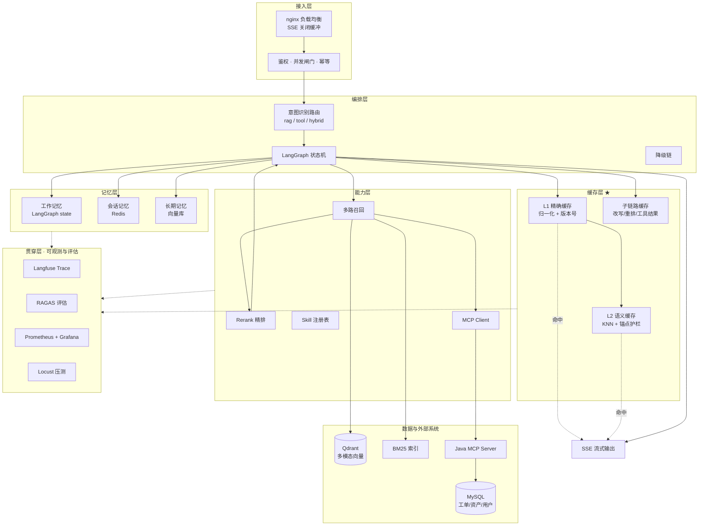

# 企业智能运维 Agent 平台

> 面向 IT 运维场景的多模态知识问答与工单自动化 Agent。
> 私有化一键部署、多路召回 + 精排、两级语义缓存、全链路可观测。
> 所有性能数字均来自本地可复现实验，测量条件随指标一并标注。

---

## 1. 为什么是这个场景

转行求职时，个人项目最大的风险是"什么都做了，但讲不清为什么"。
所以这里只讲**一条业务故事**，把所有技术点挂在这条故事上：

| 运维场景的天然难点 | 对应的技术能力 | 为什么面试官会认可 |
|---|---|---|
| 排障手册是 PDF/Word，报错截图是图片 | 多模态知识库（文本 + 图像） | 双模态是真需求，不是为了凑数 |
| 同一个问题，答案可能在手册、历史工单、资产台账里 | **双路**召回（向量 / BM25）+ 工具层 | 能讲清"哪类数据**不该**进向量库" |
| "SRV-0001 现在什么状态"是实时数据 | MCP 工具调用，而不是 RAG | 区分 RAG 与工具调用是分水岭 |
| 高频问题反复被问（VPN、密码、账号） | 两级语义缓存 | 直接对应降本增效，客户最关心 |
| 客户环境里向量库/LLM 都会挂 | 熔断、重试、降级链 | Java 工程经验的直接迁移 |
| 客户一定会问"为什么答错了" | 自建标注集 + 分层归因 | 绝大多数候选人没有这一环 |

**统一叙事（简历用）**：从单文档 RAG 服务（cs-agent，Hit@5 100%、MRR 0.8417）
迭代为企业级多知识库 Agent 平台，补齐多路召回、语义缓存、工具接入与可观测体系。

---

## 2. 架构



---

## 3. 快速开始

### 3.1 全栈启动（需要 Docker）

```powershell
cd D:\ai-project\ops-agent

Copy-Item .env.example .env      # 填 DEEPSEEK_API_KEY

.\scripts\dev.ps1 build          # 构建并启动全栈
.\scripts\dev.ps1 kb             # 建知识库（入库 + 版本号推进）
.\scripts\dev.ps1 urls           # 查看所有服务地址
```

### 3.2 只验证入库链路（不需要 Docker、不需要模型）

语料的切块、建索引、建图谱、召回率评估这些"逻辑正确性"部分，
**不依赖任何外部服务**，可以单独跑：

```powershell
python -m scripts.gen_image_transcripts     # 截图 → OCR 转录（离线回放用）
python -m scripts.ingest --stage build      # 切块 + 建点 + BM25 + 图谱（秒级）

python -m scripts.eval_retrieval --backend bm25 --sweep   # 关键词路召回率（真实数字）
python -m scripts.check_intent --min-accuracy 0.94        # 意图路由准确率（可进 CI 卡阈值）
python -m tests.test_chunker                # 41 项
python -m tests.test_indexing               # 76 项
python -m pytest tests/                     # 全部 128 个测试函数
```

> 这一步的意义：切块策略调一次就要重跑一轮评估，如果每轮都要等模型加载 + 容器起停，
> 一天改不了几次。把纯逻辑与外部依赖拆开，是能真正迭代的前提。

**不需要向量库在线的召回对比**（`--vector-source local` 走 build 落盘的 `vectors.bin`
做暴力扫描，与走向量库是同一段代码）：

```powershell
python -m scripts.eval_matrix --vector-source local      # BM25 / 向量 / 融合 三行
python -m scripts.bench_rerank --from-recall 20         # 重排代价：先实测候选池，再分层测延迟
```

> `--from-recall` 不是可选项。不带上它，脚本就只会用你手填的 `--pairs` 换算单题耗时，
> 而真实候选池是算出来的（默认配置下中位 **29 块**，不是 20）——
> 详见「重排的代价」一节。

| 服务 | 地址 |
|---|---|
| API 文档 | http://localhost:8080/docs |
| Qdrant 控制台 | http://localhost:6333/dashboard |
| Grafana | http://localhost:3001 （admin / admin123） |
| Prometheus | http://localhost:9090 |
| Locust 压测 | http://localhost:8089 （需先 `dev.ps1 load`） |

---

## 4. 当前实现状态

**诚实标注**很重要 —— 下面的"已验证"是真跑过测试的，不是"看起来对"。

| 模块 | 状态 | 说明 |
|---|---|---|
| 缓存逻辑（keys / guards） | ✅ 已验证 | 17 项单元测试通过，含中文数字归一化、锚点护栏 |
| 缓存管理器（两级 + 单飞） | ✅ 已验证 | 19 项测试通过（用注入式假 Redis，含暴力 KNN） |
| **语料解析 + 分块** | ✅ **已验证** | 110 篇 → 391 块（另 20 张截图 → 77 块）；48 项测试通过 |
| **向量存储抽象层** | ✅ **已验证** | Qdrant / Chroma / Local 三后端同一契约，31 项测试通过 |
| **多模态入库（OCR + 描述）** | ✅ **已验证** | 20 张 → 77 块；32 项测试通过（离线回放 provider） |
| **索引层（点 + BM25 + 图谱）** | ✅ **已验证** | 468 点 / 10921 词项 / 447 边；61 项测试通过（含向量缓存复用判据） |
| **向量召回接入（多路 + 融合）** | ✅ **已验证** | 真跑过：Qdrant 468 点，向量 0.875 / 融合 0.8958（见 §6.4） |
| **CrossEncoder 重排** | ✅ **已验证（代价与收益都实测）** | 全套 48 题 0.8958→0.9201；但**线上口径只 +0.69 pp（低于分辨率）**；代价 64.7 s/题 → 已设 `RERANK_ENABLED` 开关 |
| **意图路由** | ✅ **已验证** | 标注集 52/52 · 手写对抗集 19/19（见「意图路由」一节） |
| **工具层（MCP + mock 降级）** | ✅ **已验证** | 5 个工具 · `call()` 永不抛异常 · 45 项测试通过（见「工具层」一节） |
| **SSE 端到端** | ✅ **已验证** | 事件顺序/降级/缓存命中全部有断言，59 项测试通过（见「SSE 事件协议」一节） |
| **召回率评估口径** | ✅ **已验证** | 评估与服务端**共用同一条召回链路**（见 §6.4 的收敛说明） |
| 全栈编排（compose / nginx / Prometheus） | ✅ 已就绪 | 配置文件完整，未在真实 Docker 上端到端跑通 |
| **三层记忆（工作 / 会话 / 长期事实）** | ✅ **已实现，测试覆盖** | 会话滑窗+事实外置 Redis（进程零会话状态）；记忆故障降级可见 `stage=memory`；吞吐数字待压测 |
| **LangGraph 编排** | ✅ **已实现，SSE 协议逐帧对齐** | 10 节点状态机（路由/记忆/缓存/单飞/工具∥召回并行/生成），事件协议一字未改，端点级用例全部原样通过（见「LangGraph 编排与三层记忆」） |
| Java MCP Server | 🚧 待实现 | D2 上午（工具层已按 MCP 契约留好接口） |
| 熔断降级链 | 🚧 部分 | 缓存与检索层已有降级；熔断器待接 |
| 压测脚本（TTFT） | ✅ 已就绪 | 事件流级 TTFT 测量，已改成运维语料 |
| 故障注入 / MTTR 测量 | ✅ 已就绪 | 未在真实环境跑过 |

> 测试口径：`pytest tests/` → **128 个测试函数全部通过**；
> 另外 **377 条 `check()` 型断言**（覆盖 13 个文件）已纳入 pytest 退出码。
> 全部离线，不需 Docker / 模型。
> 异步用例不需要 `pytest-asyncio` 也能跑（`tests/conftest.py` 兜底），装了则由
> `pytest.ini` 的 `asyncio_mode = auto` 接管 —— 两条路径都验证过。
>
> ⚠️ **一个已修复的测试盲区**：早期有一批用例用 `check("名字", 条件)` 累加
> 模块级 `PASS/FAIL`，但 pytest 只看 `test_*` 函数，**没人去读 `FAIL`** ——
> 于是断言全红时 pytest 依然报绿。也就是说"用例通过"这个数字里，
> 占比最大的那部分断言当时没被 gate 住。现在 `tests/conftest.py` 在
> session 结束汇总各模块的 `FAIL` 并置退出码非 0，这个盲区已经关掉。
> 关掉的当天它就抓出一条**已过期 3 个月**的断言（标注集从 40 条扩到 52 条，
> 但测试里还写死着 `len(report.scored) == 36`）。

---

## 5. 缓存设计（本项目重点）

### 5.1 为什么需要两级

| 层级 | 匹配方式 | 命中场景 | 实现 |
|---|---|---|---|
| L1 精确 | 归一化后完全一致 | FAQ、固定流程，企业场景占比 30%+ | Redis String |
| L2 语义 | query 向量 KNN ≥ 0.96 | "奖金怎么算" vs "奖金如何计算" | Redis Stack + RediSearch |
| L3 子链路 | 改写 / 重排 / 工具结果 | 动态数据，短 TTL | Redis String |

**缓存查询必须早于任何检索动作**。把缓存放在生成前只能省 LLM 那一段，TTFT 收益直接砍半。

### 5.2 时效性 vs 响应速度：这是两个相反的指标

| 指标 | 缓存的作用 | 本项目的处理 |
|---|---|---|
| 响应时效性（latency） | ✅ 大幅提升 | 命中时 TTFT 从秒级降到毫秒级 |
| 数据时效性（freshness） | ❌ 会损害 | 版本号强失效 + 分级 TTL |

**分级 TTL 策略**（`app/cache/manager.py`）：

- 稳定知识（手册、制度）→ 24h
- 语义缓存 → 6h（误命中代价更高，所以更短）
- 动态数据（工单状态、资产）→ 30s，或干脆不缓存
- 空结果 → 60s（防穿透）

### 5.3 版本号强失效：不删缓存的失效

```python
# 知识库更新后只需调用一次
await cache.bump_kb_version()      # 版本号 +1
```

所有 key 里都带 `kb_version`，版本号一变旧 key 自然无人去读，**不需要 SCAN + 批量 DEL**，
也不会在删除过程中产生脏读。

版本号存在 Redis 而不是进程内存里 —— 多副本场景下，如果只存在本地内存，
A 副本自增了 B 副本不知道，会出现"一半新数据一半旧缓存"的脏读。

演示用接口：
```powershell
.\scripts\dev.ps1 bump      # 版本号 +1，全副本缓存即时失效
.\scripts\dev.ps1 stats     # 查看当前版本号与内存占用
```

### 5.4 语义缓存的护栏：向量像 ≠ 语义等价

这是语义缓存**最危险的失效模式**，也是这个项目里最值得写进简历的一个细节：

> "16 岁能独立签合同吗" 与 "18 岁能独立签合同吗"
> 余弦相似度常年 0.97+，但法律后果完全相反。

所以命中前必须过两道护栏（`app/cache/guards.py`）：

1. **数字锚点一致性**：抽取问题中的数字/量词组合（含中文数字归一化，"十六周岁" → "16"），
   两边必须完全一致。一方有、一方没有也拒绝。
2. **长度比**：差距超 3 倍视为意图已变。

保守优先是刻意的取舍：**宁可多打一次 LLM，也不能让用户按错条款办事**。
代价是损失一部分潜在命中率，这个取舍本身在面试里就是加分项。

### 5.5 单飞（singleflight）—— 以及为什么没有无脑上

同题并发时只放一个请求进后端，其余等它的结果。**但要诚实说明它的代价**：

- 收益：保护后端、省 token、压测时错率好看
- 代价：**跟随者的延迟等于领跑者的完整生成时间**，可能比各算各的更慢

所以本项目把它做成可开关的（`CACHE_SINGLEFLIGHT_ENABLED`），并设置跟随者等待上限
（`CACHE_SINGLEFLIGHT_WAIT`，超时自己算）。这个"什么时候不该用"的回答，
比"我用了 singleflight"有价值得多。

### 5.6 其他防护

| 风险 | 手段 | 位置 |
|---|---|---|
| 击穿 | singleflight 互斥锁 | `acquire_singleflight` |
| 雪崩 | TTL 随机抖动 ±10% | `_ttl()` |
| 穿透 | 空结果短 TTL 缓存 | `set_exact` 按答案是否为空选 TTL |
| 锁名不一致 | 用 SHA1 而非内置 `hash()` | `lock_key()`，内置 hash 受 PYTHONHASHSEED 影响 |

### 5.7 缓存相关指标

`cache_requests_total{layer, result}` 的 `result` 有 `hit` / `miss` / `rejected` / `error` / `stale` 五种 ——
把 `rejected`（护栏拦截）单独统计，才能看出阈值调得对不对。

---

## 6. 五大指标的测量口径

> 每个数字都必须能说出测量条件。这一节是简历里所有数字的来源。

### 系统可用性 → 重新定义为「故障注入下的请求成功率」

```powershell
.\scripts\dev.ps1 fault stop-qdrant   # 断掉向量库
.\scripts\dev.ps1 fault stop-redis    # 断掉缓存
```

对比实验：**开启降级链 vs 关闭降级链各测一轮**，只报前者没有说服力。

写入简历的形态：
> 注入 3 类依赖故障（向量库断连 / 缓存不可用 / 外部系统超时），
> 降级链生效下请求成功率保持 100%（召回失败时降级为无资料应答），
> 关闭降级时跌至 XX%。

### TTFT

```powershell
.\scripts\dev.ps1 load-ci
```
Locust 报告里会同时出现 `SSE/chat/stream`（端到端）与 `TTFT/first_token`（首 token）两行。
**TTFT 必须解析 SSE 事件流来测**，普通压测工具的"首字节"测的是 `meta` 事件，不是 token。

### 并发数

阶梯加压 10 → 30 → 50 → 80 → 120，判定口径固定为：
**错误率 < 1% 且 TTFT P95 < 3000ms 时能撑住的最大用户数。**

横向扩展证明：
```powershell
.\scripts\dev.ps1 sky            # 扩展到 3 副本
# 同样跑一轮压测，对比吞吐
```

### 上下文召回率

```powershell
# 主入口：一个进程跑完整对比矩阵（模型只加载一次），并做两条向量路径的一致性校验
python -m scripts.eval_matrix --vector-source qdrant --parity
python -m scripts.eval_matrix --vector-source qdrant --rerank --only RRF   # 只跑 RRF 那一行 ±重排
python -m scripts.eval_matrix --vector-source local                        # 不需要向量库在线

python -m scripts.eval_retrieval --backend bm25 --sweep   # 关键词基线（离线、秒级）
.\scripts\dev.ps1 eval                                    # 容器内跑（需全栈）
```

口径：**文档级** `context recall@k = 命中 golden 文档数 / golden 文档总数`。
评价单位是"文档"而不是"块"，因为用户关心的是"该看的那篇有没有被找到"；
压成文档级还能让"一个文档的多块占满 top-k"这种退化现象无处藏身。

#### 已实测：关键词单路基线（2026-10-16，无需模型）

| k | recall@k（严格） | recall@k（图谱一跳扩展） | hit_rate@k |
|---|---|---|---|
| 1 | 0.5590 | 0.8542 | 0.7083 |
| 3 | 0.7639 | 0.9861 | 0.9375 |
| 5 | **0.8646** | 1.0000 | 0.9375 |
| 10 | 0.9236 | 1.0000 | 0.9792 |
| — | MRR **0.8194** | | |

> 测量条件：BM25（CJK 字符二元组分词，k1=1.5 / b=0.75）· 468 块 · 52 条题（48 条有 golden）·
> 候选池 20 · 单机单进程 · 2 ms/题 · 产物 `eval_output/retrieval_bm25_baseline-bm25-longform_*.json`

**这张表本身就是一个结论：提升空间在 @1，不在 @5。**

BM25 在 @5 已经有 0.86，靠堆 recall@5 讲不出故事；但 @1 只有 0.56 ——
也就是说"目标文档排在第一位的比例"刚过一半。**Rerank 的价值主要在 @1 与 MRR**，
如果只报 recall@5，重排的贡献会被严重低估。所以评估脚本一次给出 4 档 k + MRR，
而不是只报一个 @5。

##### 这个 0.8646 不能直接和旧基线 0.8519 比

同一批题、同一口径才有可比性。本轮同时改了两样东西（语料 +5 篇长文档、切块器修 3 个 bug），
所以必须把题目集拉齐再看：

| 口径 | recall@5 | MRR | 说明 |
|---|---|---|---|
| 旧基线（105 篇 / 402 点 / 36 题） | 0.8519 | 0.7936 | 上一轮记录 |
| **新语料（110 篇 / 468 点）· 同样这 36 题** | **0.8194** | **0.7593** | 苹果对苹果 → **退化 3.25pp** |
| 新增 12 道长文档题 | 1.0000 | 1.0000 | 12 题全部首命中位次 = 1 |
| 合起来的 52 题 | 0.8646 | 0.8194 | **不能读成"提升了"** |

合并后的 0.8646 高于 0.8519，纯粹是**题目集构成变了**：新加的 12 道长文档题
都是单 golden、专有词密度高，BM25 一击即中，把均值抬了上去；
而原有那 36 题在共享口径下其实**退化了 3.25pp**。只报合并数字就是自欺。

逐题 diff 定位到退化只有 3 题、且 0 题改善：

| 题号 | recall@5 | 归因 |
|---|---|---|
| q-4（熔断器参数） | 1.00 → 0.50 | 与长文档无关：top-5 里没有新长文档，是切块器修复改变了短文档块的上下文头文本 |
| q-14（慢 SQL → 连接池 → 雪崩） | 0.33 → 0.00 | `pm-payment-outage-2026q2`、`spec-tracing-standard-v2` 挤进 top-5 |
| q-27（风控 fail-open） | 0.67 → 0.33 | 同上两篇长文档挤进 top-5 |

**结论：2 题退化是长文档作为"真实干扰项"造成的，1 题是切块文本变化造成的。**
这正是加长文档想要的压力 —— 语料变得真实之后，BM25 的短板开始暴露，
向量召回 + 重排的收益才有可量化的对照空间（原来 @5=0.85 的"高分"里，
有相当一部分是语料太短太干净换来的）。

**另一个必须一起报的口径**：图谱一跳扩展。多模态题标的是"该看哪篇处置文档"，
而向量库里先被召回的是截图块；不允许扩展会把这类题算成失败，那不是检索错了。
两个数字都给才是诚实的。

> ⚠️ 已知局限：扩展口径在 k=1 就能到 0.85，是因为它把 top-1 文档的**所有邻居**都算进来，
> 于是"边多的文档"天然占便宜。这个指标可以用来证明图谱的价值，但不能单独作为
> 检索质量的主指标 —— 主指标必须是严格口径。

#### 已实测：向量召回 + 融合（2026-10-16，Qdrant 468 点，真实模型）

一条命令产出全部格子（模型只加载一次）：

```powershell
python -m scripts.eval_matrix --vector-source qdrant --parity
python -m scripts.eval_matrix --vector-source qdrant --rerank    # 追加「加重排」列
```

| 口径 | recall@5 | 扩展口径 | hit_rate@5 | **MRR** | 召回 P50 |
|---|---|---|---|---|---|
| BM25（基线） | 0.8646 | 1.0000 | 0.9375 | 0.8194 | **1.9 ms** |
| 向量（Qdrant） | 0.8750 | 0.9792 | 0.9583 | **0.8667** | 599 ms |
| 向量 + BM25 + RRF | **0.8958** | 0.9792 | 0.9583 | 0.8660 | 545 ms |
| 向量 + BM25 + RRF + **重排** | **0.9201** | **1.0000** | **0.9792** | **0.8873** | 64.7 s/题 |

> 最后一行是**全套 48 题**实测，但它的收益有 72% 会被"进上下文"的块数预算吃掉 ——
> 见下面「重排那一格」的**线上口径**，那一节才是结论。

增量（同一批 52 题、同一条链路，每次只多一个东西）：

| 步骤 | Δrecall@5 | ΔMRR | 怎么读 |
|---|---|---|---|
| BM25 → 向量 | **+1.04pp** | **+4.72pp** | 覆盖只涨一点，**排名涨得多** |
| 向量 → 向量+BM25+RRF | **+2.08pp** | −0.07pp | 覆盖继续涨，**排名不再涨** |

**三个反直觉的结论，外加一个"收益被吃掉"的发现，都值得在面试里讲。**

**① 向量的主要贡献是"排得准"，不是"找得到"。**
recall@5 只涨 1.04pp，但 MRR 涨 4.72pp（0.8194 → 0.8667）。
这正好印证了 §6.4 上一节从 BM25 基线推出的预测 —— *提升空间在 @1，不在 @5*。
如果只报 recall@5，向量这一路的价值会被低估 4 倍以上。

**② RRF 融合提升覆盖，但不提升排名。**
recall@5 涨 2.08pp（0.8750 → 0.8958），MRR 却几乎没动（−0.07pp）。
原因很具体：RRF 是**排名融合**，它擅长把"两路都命中"的文档顶上来，
但两路都命中的文档本来就在前列 —— 所以对 @5 有帮助（它能把某一路漏掉的
文档从另一路捞进池子），对"第一名"却几乎无影响。
**想让 MRR 再上一个台阶，只能靠重排，不能靠加召回通道。**
这句话可以直接回答"你为什么还要上 Reranker"。

**③ 图谱扩展口径反而降了（1.0000 → 0.9792），这是好事。**
BM25 的 1.0000 是"top-5 的邻居恰好覆盖了所有 golden"——典型的
**指标饱和**（恒为 1.0 的指标没有分辨力，见上一节的局限说明）。
向量召回换掉了部分 top-5 文档后它就掉到 0.9792，说明这个口径
确实对 top-5 的构成敏感，而不是一个恒真式。主指标仍然必须是严格口径。

**④ 重排的收益有一大半会被"进上下文"的块数预算吃掉。**
pool 口径下重排 +2.43pp，但换到**用户实际拿到的上下文口径**只剩 **+0.69pp**，
低于 48 题下 2.08pp 的分辨率 —— 也就是说，在当前预算下**证明不了它对用户有帮助**。
真正该先动的是上下文预算（`rerank_max_per_doc` / `top_k_rerank`，几乎免费），
而不是排序模型（64.7 s/题）。详见下一节「重排那一格」。

> 这一条比前三条更容易被追问，因为它推翻了一个很常见的直觉：
> "更贵的排序模型 = 更好的答案"。**预算不变时，更好的排序没有地方体现。**

> 测量条件：BGE-small-zh-v1.5（512 维）· Qdrant 单机（`ops_kb` 集合，468 点）·
> BM25 CJK 二元组 · 52 条题（48 条有 golden）· k=5 / 候选池 20 / 每路文档上限 3 ·
> 单机单进程 CPU · 产物 `eval_output/matrix_qdrant_*.json`。
> 召回率不受算力影响（同样的检索结果）；**延迟绝对值在这台机上不可复现，
> 只可看同轮内的相对差异** —— 原因见「冷启动与延迟分解 · 先说清楚这台机器的算力」。

#### 「一致性校验」：两条向量路径必须给出同一个答案

评估脚本可以选择走**本地暴力扫描**（读 build 落盘的 `vectors.bin`）还是走**向量库**。
这两条路径是天然的控制组 —— 同一个模型、同一批向量、同一种余弦相似度，
差异只应来自近似索引（HNSW）的取舍。

```powershell
python -m scripts.eval_matrix --vector-source qdrant --parity
```

实测结果：

| 项 | 值 |
|---|---|
| top-5 文档平均重合率（Jaccard） | **1.0000** |
| 本地暴力扫描 recall@5 | 0.8750 |
| 向量库 recall@5 | 0.8750 |
| 向量库降级题数 | 0 |

完全一致。这条校验通过，上面那张矩阵表里的向量格才**有资格**被引用 ——
如果不一致，问题在向量库侧的距离度量/归一化/过滤配置，而不在模型。
这也是 `brute_force_search` 这个"看起来多余"的函数存在的理由。

#### 为什么评估脚本不再自己实现检索（本轮最重要的重构）

之前 `eval_retrieval.py` 自己写了 `rrf_fuse`、自己拼 BM25 排名、自己扩池重排。
结果是"评估"与"线上"成了两条代码路径，差异**至少**有四处：

| 环节 | 旧评估脚本 | 线上（`app/pipeline/rag.py`） |
|---|---|---|
| `kb_version` 过滤 | ❌ 无 | ✅ 有（store 侧 + Chunk 侧双保险） |
| 每路文档占比上限 | ❌ 无 | ✅ 有（**融合之前**施加） |
| 融合粒度 | 文档级 | 块级 |
| 重排候选池 | 命中文档的**全部**块 | 只重排已召回的块 |

四处偏差方向不一致：没有版本过滤会**虚高**（旧版本点也算命中），
扩池重排也会**虚高**（候选更多），而没有占比上限会**压低**。
叠在一起得到的数字既不是线上的、也不是干净的消融 ——
它是**某个别的系统**的分数。而这类偏差**不报错、不告警、不使任何测试变红**。

现在：检索**全部**走服务端的 `recall_detailed`，消融变成 `RecallConfig` 的
显式字段（哪些通道 / 是否融合 / 池子多大 / 向量索引来自哪里）。
差异是**参数**，不是代码分叉。`tests/test_recall_convergence.py` 里的
`test_eval_calls_serving_recall` 会盯着这件事 —— 有人重新在 eval 里写一份检索，它会红。

**重排要报两个口径，因为它们是两个不同的东西：**

| 口径 | 定义 | 回答的问题 |
|---|---|---|
| `pool` | 重排分当排序信号，池内全部候选重排后取 top-5 文档 | 重排的**排序**有没有变好（与未重排基线唯一变量可比） |
| `served` | 线上真实截断（每篇最多 2 块、只带 5 块进上下文）后投影到文档级 | 用户**实际拿到**的上下文里有没有目标文档 |

只报 `pool` 会让重排显得比实际更好；只报 `served` 又无法与基线对比。
两个都打出来，并注明块数上限这个变量。

#### 重排那一格：收益、代价，以及一个反直觉的结论

全套 48 题（`--only RRF`，± `--rerank`；同批题、同一条链路，只改"是否重排"这一个变量）：

| 口径 | pool recall@5 | 线上口径 recall@5 | MRR(pool) | MRR(线上) |
|---|---|---|---|---|
| 向量+BM25+RRF | 0.8958 | **0.8785** | 0.8660 | 0.8785 |
| 向量+BM25+RRF **+ 重排** | **0.9201** | **0.8854** | **0.8873** | **0.8854** |
| **增量** | **+2.43 pp** | **+0.69 pp** | +2.13 pp | +0.69 pp |

**两个口径给出的答案完全不同，而这正是重点。**

- **pool 口径**（重排分当排序信号，池内全部候选重排后取 top-5 文档）：**+2.43 pp**
- **线上口径**（每篇最多 2 块、只带 5 块进上下文）：**+0.69 pp**

**重排约 72% 的收益在"进上下文"这一步被丢掉了**（留存率 0.0069 / 0.0243 ≈ 28%）。

再看截断本身的代价 —— 它在加了重排之后**翻了一倍**：

| 配置 | pool | 线上 | 截断吃掉 |
|---|---|---|---|
| 不重排 | 0.8958 | 0.8785 | −1.73 pp |
| 加重排 | 0.9201 | 0.8854 | **−3.47 pp** |

原因不神秘：重排把一批**内容更相关、但来自同一篇文档**的块提到前面，
而"每篇最多 2 块"正好把它们砍掉。
**排序变好了，但预算没变，好排序就没地方体现。**

> 📌 **结论（这一节最值得讲的一句）**
>
> 48 题下 1 题 = **2.08 pp**，而线上口径的增量只有 **0.69 pp** ——
> **低于测量分辨率**。也就是说：在当前上下文预算下，
> **无法证明重排对"用户实际拿到的上下文"有可测量的帮助**。
>
> 瓶颈是**上下文预算**（`rerank_max_per_doc=2` / `top_k_rerank=5`），
> **不是排序模型**。正确顺序是先放开预算（几乎免费），再考虑为排序付费。
> 而重排的代价是实测 **64.7 s/题**（`rerank_ms_avg`）。

**为什么必须两个口径都打出来：** 只报 pool，你会得出"重排 +2.43 pp、值得"；
只报线上，你没法与基线比。**两个一起看，才知道收益是被谁吃掉的。**

> ⚠️ **一个已修正的口径漏洞**：早期实现只对**重排格**算线上口径，
> 非重排格直接沿用 pool 值 —— 那等于拿「重排 + 真实截断」
> 比「不重排 + 不截断」。后者在线上根本不存在（`RERANK_ENABLED=false` 时
> 走 `_no_rerank_order()`，照样先限每篇块数再截断），
> 所以那个对比会**系统性偏袒重排**。现已修正为**每一格都算线上口径**
> （`scripts/eval_retrieval.py::run_cell`）。

##### 小样本是怎么骗人的（一个真实例子，留着当反面教材）

先前只跑了前 15 题，得到 pool 0.9333 / 线上 0.9333 —— **两个口径完全相等**，
看起来"线上截断没有任何损失"。扩到全套 48 题后，截断的代价是 **−3.47 pp**。

15 题时 1 题 = 6.7 pp，−3.47 pp 这种量级的差异**根本不可能被分辨出来**。
所以：**小样本不是"结论弱一点"，是会给出方向性错误的结论。**

**为什么当初是 15 题而不是 52 题：重排一格要跑约 50 分钟。**
52 题 × 56 s/题（机器空闲时实测前 4 题为 223 s，线性外推；
有其它进程争用时实测约 66 s/题 → 临近 1 小时）—— 而"没人愿意跑的实验
等于不存在"。所以脚本提供 `--only` 与 `--limit` 两个筛选开关：

```powershell
# 只跑 RRF 这一行的 ±重排（其余格子跳过）
python -m scripts.eval_matrix --vector-source qdrant --rerank --only RRF

# 想先看方向再决定要不要跑全套（⚠ 小样本会给出方向性错误的结论，仅用于估时）
python -m scripts.eval_matrix --vector-source qdrant --rerank --only RRF --limit 15
```

`--limit` 会打 `WARNING` 并在产物 JSON 里写 `"limited_sample": true` ——
**小样本不会被误当成全套结论**，因为它自己就声明了。

> 全套产物：`eval_output/matrix_qdrant_rerank_20261016-210136.json`（含重排）
> 与 `eval_output/matrix_qdrant_20261016-210443.json`（不含重排，用于同口径对比）。

---

### 意图路由（规则优先，可评估）

```powershell
python -m scripts.check_intent --min-accuracy 0.94 --min-nonrag-recall 0.85
```

四类意图，决定链路**怎么走**：

| 意图 | 链路 | 例子 |
|---|---|---|
| `rag` | 向量 + BM25 + 融合 + 重排 → 生成 | "连接池耗尽了怎么处理" |
| `tool` | MCP 工具调用 → 生成（不检索） | "INC-2026-0412 处理到哪了" |
| `hybrid` | 召回与工具**并发** → 合并两段上下文 | "SRV-0088 现在什么状态，处置文档怎么说" |
| `chitchat` | 固定话术，**不走模型、不落缓存** | "你好，你是谁？" |

**为什么规则优先而不是上 LLM 分类。** 三个理由，按重要性排序：

1. **可评估。** 规则可以对着 52 条标注集算准确率、算混淆矩阵、
   进 CI 卡阈值。LLM 分类要先花一次调用、再有随机性，
   评估成本高一个量级，而且"这次的 0.92 和上次的 0.94 是不是同一个模型"说不清。
2. **可解释。** 决策带 `reason` 与 `signals`，会随 `route` 事件推给前端
   （演示时可以直接指着屏幕说"它为什么判定这是实时类问题"）。
3. **可预测。** 路由错了会直接改变答案的**性质**，
   把它放进一个带随机性的组件里，等于让最不该抖的一环去抖。

LLM 兜底留了开关（`INTENT_LLM_FALLBACK=false`），**默认关闭** ——
没有评估支撑的兜底只是"多一次调用"，不是"更准"。

#### 误判代价是不对称的

| 误判方向 | 后果 | 严重性 |
|---|---|---|
| `rag` → `tool` | 拿实时数据回答知识问题，**答案凭空错** | 🔴 不可察觉 |
| `tool` → `rag` | 检索不到工单，模型如实说"资料未涉及" | 🟡 可恢复 |

所以默认偏向 `rag`，只有在**明确出现实时信号**时才判为 live。
这个不对称是整个规则集的设计约束，不是微调出来的。

#### 实测准确率

| 口径 | 结果 |
|---|---|
| 标注集全量 | **52 / 52 = 1.0000** |
| 其中非 rag 类（tool + hybrid + chitchat） | **7 / 7 = 1.0000** |
| 手写对抗集（19 句，**从未用于调参**） | **19 / 19 = 1.0000** |

> `python -m scripts.check_intent` 会同时打印"全部判为 rag 能得多少分"= **0.8654**。
> 这个提示是刻意加的：52 题里 45 题是 rag，一个**只会输出 rag 的函数**就有 86.54% 准确率。
> 所以**准确率单独报没有意义**，必须同时报非 rag 类的召回率 ——
> 后者才是路由真正在做的事。

对抗集独立存在的理由：规则是在那 52 条标注上调出来的，
拿同一批数据报准确率有**乐观偏差**。对抗集是手写的、故意不像标注措辞的句子，
它通过才说明规则**泛化**了而不是**记住**了。
`tests/test_intent.py` 的回归断言用的是**阈值**（0.94 / 0.85）而不是 1.0 ——
对着标注集调参到 1.0 是过拟合，不是成就。

#### 调参过程中真正踩到的三个坑

**① 正则的空分支会匹配一切。**
`LIVE_VERBS` 里一个多余的 `|` 让分支变成 `(?:a|b|)`，而空串永远匹配 ——
于是**每一句话都被判为实时类**，准确率从 1.0 崩到 **0.1346**。
这个 bug 唯一被发现的理由是"第一次跑出来的数字荒唐得不像是真的"。
教训：正则写完后必须显式验证它**不匹配**什么。

**② 裸动词会误伤专业术语。**
`查询` 无条件命中，于是"**慢查询**怎么优化"被判成实时类。
修法是让动词**必须带宾语**（`查询(工单|资产|告警|日志|...)`）。
同一类问题还有 `此刻` + `告警`：一个讲"监控大盘此刻同时告警说明什么"的
**知识问题**被误判成实时告警查询。修法是把 工单/告警 从实时宾语集合里**移出去** ——
它们既可能是"查一下某张工单"，也可能是"工单流转规则是什么"。

**③ 闲聊要按小句匹配，不能整串匹配。**
`你好，你是谁？你能帮我做什么？` 是三个小句，
整串正则匹配不上，于是被判成 `rag` 去检索了一轮。
修法是按标点切小句，**要求每个小句都是闲聊**才算闲聊
（出现任意一个实质小句就不是）。

---

### 工具层：MCP 优先 + mock 降级，且 `call()` 永不抛异常

5 个工具，签名集中定义在 `app/tools/providers.py` 的 `TOOL_SPECS` ——
`MockProvider` 与 `McpProvider` 共用同一份定义，所以"mock 能用、MCP 对不上"
这种错配在**启动时**就会暴露（`install()` 走 `getattr`，缺实现直接炸）。

| 工具 | 用途 |
|---|---|
| `query_ticket` | 按工单号查详情 |
| `search_tickets` | 按关键词搜工单 |
| `query_asset` | 按资产编号查状态 |
| `query_alerts_by_service` | 查某服务**未关闭**告警 |
| `list_open_tickets` | 列未结单工单 |

**`call()` 永不抛异常** —— 未知工具 / 超时（默认 3 s）/ 参数错误 / 下游异常，
全部收敛成 `ok=False` 的 `ToolResult`。

这不是"吞异常"。关键区别在于：**失败的调用会被渲染进 LLM 上下文**，
所以模型会说"未查询到"而不是编造 —— 一个真实的 0 条和一个查询失败，
对用户是两件必须区分的事：

```
query_alerts_by_service(service=inventory-service)
  → 服务 inventory-service 的未关闭告警：0 条（该服务当前没有未关闭的告警）
```

**`source` 字段是诚实性要求。** 每个结果带 `mock | mcp | cache | none`，
并随 SSE 推给前端 —— 演示时用的是 mock 数据，界面上会如实标注是 mock，
不会让观众误以为是实时数据。

**MCP 优先 → mock 降级放在调用点，不在 MCP 客户端内部重试。**
D1 阶段 Java MCP Server 还不存在，所以"探测失败就用 mock"；
探测结果有 30 s 的 TTL 缓存，避免每次调用都去 ping 一个已知不存在的服务。

**缓存只缓存成功。** 30 s TTL 的结果缓存按**排序后的参数**拼 key
（否则 `(a,b)` 与 `(b,a)` 会算成两个 key）；失败**不缓存**，
否则一次网络抖动会被放大成 30 秒的持续失败。

**只返回 `firing` 的告警。** 把 `resolved` 也返回会让模型把已经恢复的
故障汇报成"正在发生"—— 这类错误看起来非常真实，因而非常危险。
标注集 q-36 专门测这一点，语料里的告警数据也是**按这个断言构造**的
（`inventory-service` 只有 resolved、没有 firing），
所以"没有未关闭告警"这个答案与数据自洽，而不是靠模型猜。

---

### SSE 事件协议（前端与压测脚本的契约）

| 事件 | 时机 | 关键字段 |
|---|---|---|
| `meta` | 最先 | `cache`（exact/semantic）、`similarity`、`kb_version` |
| `route` | 紧随其后 | `intent`、`reason`、`signals`、`entities` |
| `tool_call` | 调用前 | `tool`、`args` |
| `tool_result` | 每次返回 | `ok`、`source`、`elapsed_ms`、`summary` |
| `tool_summary` | 全部结束 | `ok_count` / `total` |
| `docs` | 检索完成 | `sources`、`pages`、`recall_sources`、`channels`、`fused` |
| `token` | 流式正文 | `text` |
| `degraded` | 任一环节降级 | `stage`、`reason` |
| `error` | 致命 | `message` |
| `done` | 收尾 | `cache`、`route`、`stage_ms`、`total_ms` |

三处非显然的设计：

**① 心跳用 `asyncio.wait` 轮询，不是 `wait_for`。**
`wait_for` 只能表达"最多等 N 秒然后超时"，表达不了"还没好就继续等"。
nginx 默认 60 s 空闲就断连接，长回答（尤其带工具调用）会超过这个时间。
所以每 15 s 推一个 `: keepalive` 注释帧。压测时这条直接决定"连接是不是被中间层杀掉的"。

**② `kb_version` 从缓存取，不从 settings 取。**
`settings.kb_version` 是**进程启动时的快照**。`/admin/kb/burn` 把版本号 +1 之后，
settings 里还是旧值 —— 于是 SSE 事件里的版本号会**撒谎**。
它必须从缓存读运行时值。

**③ 闲聊短路：不走模型、不写缓存。**
问"你好"也走一遍检索 + LLM 是纯浪费，而且回答不稳定。
闲聊用固定话术直接返回，且**不落缓存** —— 因为它本来就没有成本，
落缓存只会污染命中率统计（让命中率看起来虚高）。

`tests/test_chat_sse.py` 断言的是事件的**相对顺序**，不是集合。
理由：事件顺序就是前端的渲染逻辑，顺序错了前端不报错、只是显示得不对 ——
这类问题人工点几下基本看不出来。

---

### LangGraph 编排与三层记忆（D1 下午）

旧的实现是 `chat.py` 里一个手写 async generator：路由 → 缓存 → 分支 → 生成，
状态靠函数参数在调用栈里传。链路短时这样最简单，但要叠三层记忆、
断点续跑、工具人工确认时，它会膨胀成难以维护的隐式状态机。
编排已重构为 **LangGraph 状态机**（`app/pipeline/orchestrator.py`）：

```
START → route ──chitchat──▶ chitchat → END
          │ main
          ▼
     memory_load → embed → cache_lookup ──hit──▶ END
                                │ miss
                                ▼
                           singleflight ──跟随者命中──▶ END
                                │ 领跑者
                                ▼
                             dispatch ──┬──▶ tools ──┐
                                        └──▶ recall ─┴─▶ generate → END
```

**重构的验收标准是"SSE 事件协议一字不改"**：`tests/test_chat_sse.py` 的
端点级用例不改断言、只改两个 patch 目标（`embed_one` / `plan` 随编排器搬家），
全部原样通过 —— 事件顺序错了前端不会报错，只会显示得不对，
所以"协议不变"必须是测试能抓住的性质，而不是口头承诺。

三个值得讲的实现决策：

**① 节点内的流式输出走 `stream_mode="custom"`。**
token 是逐段产生的，节点不能等整段生成完再返回状态。
每个节点经 `get_stream_writer()` 把帧推给外层 SSE 生成器，端点只透传 ——
协议归编排器管，端点只做鉴权 + 并发闸门。

**② 扇出并行由图结构保证，不靠手工起任务。**
hybrid 的 tools 与 recall 两路无依赖，`dispatch` 节点扇出、LangGraph
在 `generate` 前自动汇合。旧的"先启动召回任务再跑工具"手工并行被
`test_orchestrator_graph.py::test_fanout_is_parallel` 钉住 ——
如果有人把扇出改回串行，事件顺序不变、只有延迟悄悄变成两路相加，
端点用例抓不住它，拓扑测试能。

**③ 记忆降级事件必须"补发"而不是"抢发"。**
记忆是唯一可能**在 meta 之前**就失败的环节（`memory_load` 排在缓存查询前），
而 meta 必须是第一帧。所以 load 失败先记进 state 的 `degraded`，
由携带 meta 的节点在 meta 之后补发 `stage=memory` 事件。

三层记忆的分界（代码对应 `app/memory/`）：

| 层 | 承载 | 生命周期 | 位置 |
|---|---|---|---|
| 工作记忆 | `AgentState`（路由决策/向量/召回块/降级清单） | 单次请求 | 进程内（LangGraph state） |
| 会话记忆 | 最近 N 轮问答（默认 10，滑窗截断） | 24 h | Redis list `ops:sess:{sid}:hist` |
| 长期事实 | 规则抽取的稳定属性（角色/技术栈） | 7 天 | Redis hash `ops:sess:{sid}:facts` |

- **进程内零会话状态**：多副本横向扩展时任意副本可接任意请求 ——
  这是"3 副本吞吐提升"那条指标的前提，没有它压测数字不成立。
- **事实抽取是规则版 v1**：LLM 抽错一条事实，它会在后续每轮都被注入
  prompt，错误半衰期是整个会话且用户看不到；规则版覆盖率低但每条
  可解释、可单测，且带**否定护栏**（"我们不用 MySQL"不进事实库）。
  LLM 抽取（带置信度+确认）在 backlog。
- **记忆故障的三重防御**：store 层吞异常（load 返空/save 返错误串）→
  编排层兜 store 违约 → SSE 补发 `stage=memory` 降级。
  记忆静默失效是最危险的失败模式 —— 请求照常返回，只是不带历史，
  用户根本不知道有这回事。
- **总开关 `SESSION_MEMORY_ENABLED=false`**：压测用它把记忆层排除在测量外。

> ⚠️ **尚未接 checkpointer**：LangGraph 的断点续跑/时间旅行依赖
> checkpointer，官方 Redis 实现需额外安装包（离线环境暂未引入），
> 暂以自管 Redis 会话层替代。接入时只需安装依赖并把
> `thread_id=<session_id>` 传入 `astream` 的 config，图结构无需改动。
> 列入 §11 backlog。

---

### 冷启动与延迟分解

`app/main.py` 的 lifespan 预热顺序是有讲究的：

```
cache → tools → 索引产物预读 → **向量库预热** → 模型预热
```

**向量库预热是必须的，不是优化。** 实测（本机 Windows，468 点）：
Qdrant 的**首次**查询要 **8.9 秒** —— 服务端要把 HNSW 索引加载进内存，
之后稳定在数百毫秒。不预热的话：

- 第一个真实用户要白等这 9 秒；
- 更糟的是**压测场景**：阶梯加压的第一档就是第一个请求，
  这 9 秒会被当成"这一档并发撑不住"的证据 —— 一个纯粹的误判，
  而且它看起来很像真的。所以预热是**让后续测量有效**的前提。

**模型加载是大头，且它是 import 不是推理。** 本机实测：

| 模型 | 首次可用耗时 | 其中权重读取 |
|---|---|---|
| `bge-small-zh-v1.5`（向量） | 约 110 s | 几秒 |
| `bge-reranker-base`（重排） | **87.1 s** | 几秒 |

绝大部分时间是 `sentence-transformers` / `torch` 的**导入与初始化**
（权重实际读取只要几秒）。所以：

- 容器启动时间会很长，`docker-compose` 健康检查的 `start_period` 必须给够，
  否则容器会被反复判定为不健康并重启；
- 这个代价只付一次，**不能**混进 TTFT —— 那正是"TTFT 基线是假的"的经典来源。

#### 一个实测踩到的坑：模型已缓存，却仍在联网

即使权重已经在本机缓存里，`sentence_transformers` 初始化时**仍会向 Hub 发
HEAD 请求**去核对文件元数据。在 `HF_ENDPOINT=hf-mirror.com` 下实测会遇到
`HTTP Error 429` + 指数退避重试，把模型加载时间从几十秒拖到几分钟，
而且**看起来像卡死**。

本项目的处理是分层的，这里必须区分清楚，否则会踩到反效果：

| 运行位置 | 配置 | 说明 |
|---|---|---|
| 容器内 `api` | `HF_HUB_OFFLINE=1` + `TRANSFORMERS_OFFLINE=1` | 镜像/卷里已有模型，**必须**离线，避免每次启动都去联网（私有化部署断网也能起） |
| 容器内 `build-kb` | 只给 `HF_ENDPOINT`，**不给** offline | 一次性任务要能在**首次**把模型下下来，强制离线会让冷启动直接失败 |
| **宿主机脚本** | 当前**没有**设置 | 所以 `eval_matrix` / `bench_rerank` 在宿主机跑会吃到 429 |

宿主机跑评估时建议显式离线（模型已缓存的情况下）：

```powershell
$env:HF_HUB_OFFLINE = "1"
python -m scripts.eval_matrix --vector-source qdrant --parity
```

> ⚠️ **首次部署的顺序是有依赖的**：`api` 容器带 `HF_HUB_OFFLINE=1`，
> 所以它**要求模型已经在 `huggingface_cache` 卷里**。空机器上必须先跑一次
> `.\scripts\dev.ps1 kb`（`build-kb`，能联网下载），再起 `api`；
> 否则 `api` 会以一个"模型加载失败"的姿态启动 —— 而这时容器本身是
> healthy 的（健康检查只探 HTTP），要等第一个请求才会暴露。

#### 单题召回延迟（同一轮、同一机器、52 题，P50）

| 口径 | 召回 P50 | 相对 BM25 |
|---|---|---|
| BM25 | **1.9 ms** | — |
| 向量（Qdrant） | 599 ms | +597 ms |
| 向量 + BM25 + RRF | 545 ms | +543 ms |

向量的开销主要在 embedding（CPU 上单条 query 约 0.1~1 s）而不在 Qdrant 本身。
**RRF 几乎不增加延迟**（545 ms 甚至略低于向量单路，因为两路是并发 `gather` 的）——
这是一个值得主动说的点：融合的代价是"多跑一路"，不是"串行等待"。

#### ⚠️ 先说清楚这台机器的算力，否则上面的数字会被误读

**这一节是一次自我纠错，写下来比藏起来有用。**

最初的版本里我写的是"本机 matmul 标尺 257 ms，比正常桌面慢约 6.4×"。
后来把同一条命令在**不同时间**重复了三次，得到的是：

| 轮次 | matmul 标尺 | 20 对重排 |
|---|---|---|
| 19:03 | **257 ms** | 29.6 s |
| 19:54 | **65.5 ms** | 44.5 s |
| 20:01 | **34.4 ms** | 42.4 s |

标尺在**一小时内漂了 7.5 倍**，而 20:01 那轮里 **29 对比 20 对还快**
（36.1 s vs 42.4 s）—— 这物理上不可能，只能说明测量本身不可复现。

结论有两条，第二条比第一条重要：

1. **"慢 6.4×" 是错的，撤回。** 那一次标定本身就是在 CPU 争用下测的
   （257 ms 里有我自己的并发任务）。本机真实算力大致在"正常桌面水平
   ~1.6×"这一档，而不是一个数量级。
2. **真正的结论：这台机器（共享 vCPU）的绝对延迟不可复现。**
   所以本节表格里的毫秒值**不应作为可引用数字**：
   - ✅ **可信**：同一轮里各口径的**相对差异**（BM25 ↔ 向量 ↔ RRF）
   - ✅ **可信**：召回率 / MRR 等**质量指标**（不经过计时器，与算力无关）
   - ❌ **不可引用**：任何绝对毫秒值 —— 换台机器或换个时间点都对不上
   - ❌ **不要**把 599 ms 当成"向量检索很慢"：Qdrant 本身在百毫秒内，
     这 599 ms 里绝大部分是 CPU 上的模型推理

`scripts/bench_rerank.py` 仍然会把这条标尺连同结果一起写进产物，
但它的用途变了：**不是"给你一个折算倍率"，而是"告诉你这次的数字有多大不确定性"**。
延迟数字不标注机器状态就等于没有数字，而"16 核"这种参数并不能说明算力 ——
共享 vCPU 上，同一台机的实际算力可以一天之内差好几倍。

> 📌 **这本身就是一个该讲给面试官的方法论**：先用一条与业务无关的
> 基准（matmul）标定机器，再决定"哪些数字可以引用、哪些只能看趋势"。
> 我一开始漏了这一步，把争用下的数字当成了机器属性。

#### 重排的代价：本轮最值得讲的一个取舍

```powershell
python -m scripts.bench_rerank --from-recall 20
```

**先纠正我自己犯的一个错：候选池不该写死。** `--pairs 20` 里的 20 是人为指定的，
而线上真正送进重排的块数由 `top_k_retrieve`（每路召回数）、两路重叠率、
`recall_max_per_doc`（每篇上限）共同决定 —— 不是常数。
实测（走**真实** `recall_detailed`，即线上那条路，只数块数不打分）：

| 统计量 | 候选池块数 |
|---|---|
| min | 21 |
| **中位** | **29** |
| max | 36 |
| 均值 | 28.7 |

即默认配置（`top_k_retrieve=20` + RRF）下，重排一次要打 **约 29 对**，
不是原先假设的 20 对 —— 原来的成本估算**低估了约 1.45 倍**。
（这也是为什么 `--from-recall` 会被加进脚本，而不是留一个手填的常数。）

修正后的代价 —— **三次独立测量的区间**，不是单值：

| 候选池 | 单次耗时 |
|---|---|
| 1 | 2.6 ~ 5.4 s |
| 5 | 8.6 ~ 19.0 s |
| 20 | 29.6 ~ 44.5 s |
| **29（线上实测中位）** | **36 ~ 45 s** |

**一个重要的交叉验证**：上面这张表是 *bench* 里用合成 (query, doc) 对测的，
而全套评测在**真实 52 题、真实链路**上实测 `rerank_ms_avg = 64.7 s/题`
（`eval_output/matrix_qdrant_rerank_20261016-210136.json`）。
两个数字同量级但差了约 1.5 倍，原因有两个，都值得知道：

1. 真实候选池分布有长尾（max 36 块），而 bench 用的是固定档位；
2. **bench 里一遍遍喂同一段文本，tokenizer 与注意力的 cache 行为更友好**，
   而真实题目长短不一。

→ 结论：**bench 给的是"代价的量级与形状"，报线上代价要用评测里的 `rerank_ms_avg`。**
（这也是为什么两个数字都留在 README 里，而不是只留更好看的那个。）

> 测量条件：16 vCPU / torch 12 线程 / torch 2.14.0+cpu · `bge-reranker-base` ·
> 文档 460 字（对齐 `chunker.MAX_CHARS`）· 每档重复 3 次取中位数 ·
> 产物 `eval_output/bench_rerank_*.json`。
>
> **报区间而不是单值，是刻意的**：同一台机器的算力标尺在一小时内漂了 7.5 倍
> （见上一节），给一个 3 位有效数字的单值等于给出虚假精度。
> 这台机器上**能报的是量级（几十秒/题），不是 29.6 这个数**。
>
> 早期在有 CPU 争用时还测到过 **53 s / 105 s / 166 s**，
> 以及一整轮被污染到 `rerank_ms_avg = 103 s` 的评测 —— 那些数字同理不可引用。
> 判据是同一批数据里的 `recall_ms_p50`：空闲时 545 ms，争用时 1649 ms，
> **质量指标不受影响，延迟指标直接作废**。

**结论：单次问答几十秒量级的重排，不能放在在线首答路径上。**
这不是"优化一下就好"，而是设计约束，必须给出处置方案：

| 处置 | 代价 | 本项目状态 |
|---|---|---|
| **一键关掉重排**（`RERANK_ENABLED=false`） | 丢失重排带来的排序收益 | ✅ 已实现（见下） |
| **用缓存摊薄**（`CACHE_RERANK_TTL`） | 同一 query 复用；首次仍慢 | ✅ 已实现 |
| 换更小的重排模型 / 量化 / ONNX | 精度下降，需重新评估 | 🔜 |
| 上 GPU | 成本 | 🔜 |
| 缩小重排候选池 | 召回率下降（候选少了，重排救不回来） | ⚙️ 可调 `--pool` |

**关掉重排这件事本身有个容易犯的错：静默跳过。** 所以实现上做了两件事：

1. 关闭后走的是**与"重排失败降级"完全相同的那一条路径**
   （`_no_rerank_order()`：先限每篇块数、再截断 —— 顺序不能反），
   不是另写一份"简化版"。两条路只可能有一种行为。
2. 关闭会在 SSE 里**如实标注** `degraded: rerank:disabled`。
   否则演示的人和看指标的人都不知道自己在看一条更弱的链路 ——
   那样得到的 TTFT 数字就不是"这套架构的 TTFT"，而是"少了重排的 TTFT"。

```dotenv
# .env
RERANK_ENABLED=false   # 压测 / 3 分钟演示时建议关掉，并在报告里注明
```

> ⚠️ **收益和代价必须一起报，而且代价要放在前面。**
> 只报"重排把 MRR 抬高了 2.1 个点"而不报"它要 64.7 秒一题"，
> 是最容易被一句话问住的表述：*"那你怎么不用最贵的方案？"*
> —— 因为贵到不能用。
>
> 完整的对照口径应该是这样一句话：
> **"重排让 recall@5 从 0.8958 到 0.9201、MRR 从 0.8660 到 0.8873
> —— 但那是在扩池口径下；换到用户实际拿到的上下文口径，增益只剩
> 0.69 pp，低于一题的分辨率（2.08 pp）。而代价是每道题多花 64.7 秒。
> 所以我默认把它关掉了。"**
>
> 注意这句里有两处主动交底，都不是被抓到才说的：
> ① 代价 64.7 s/题；② **收益在线上口径下几乎归零**。
> **先讲代价、再讲收益、主动说出收益的边界**，比反过来可信得多。


### MTTR

```powershell
python -m scripts.fault_inject --fault stop-qdrant --rounds 5
```
四个时间戳：T1 注入 → T2 告警 firing → T3 服务恢复。
- MTTR = **T3 - T2**（从"系统知道自己病了"到"系统能干活了"）
- 检测延迟 = T2 - T1

很多简历上的 MTTR 其实测的是 T4-T1，口径完全不同。把口径写清楚本身就是加分项。

### 加分指标（FDE 面试必问）

- 单次问答 token 成本 / 千次问答成本 → `cache_tokens_saved_total` 直接给出节省量
- rerank 引入的延迟代价 vs 召回率收益 → 主动讲取舍

---

## 7. 48 小时计划

| 阶段 | 任务 | 里程碑 |
|---|---|---|
| ~~D0 今晚~~ ✅ 已完成 | 定场景 · 语料 105 篇 + 20 张截图 · 标注 40 条 QA · 全部校验通过 | **评估集已就绪** |
| ~~D0 追加~~ ✅ 已完成 | 向量库抽象层（Qdrant/Chroma/Local 同契约）· 补 5 篇长文档压测切块 · 抓出并修复 3 个切块器 bug · 标注扩到 52 条 | **基线经同口径复核** |
| ~~D1 上午（前一半）~~ ✅ 已完成 | 语料切块 · 多模态入库 · 对话建 index · BM25 + 图谱 · 召回率评估口径 | **索引产物 + 真实基线** |
| ~~D1 上午（后一半）~~ ✅ 已完成 | 向量召回打通（Qdrant 接入 + 本地暴力扫描对照 + 一致性校验）· 意图路由 · SSE 串通 | **链路跑通** |
| D1 下午（进行中） | ~~双路召回 + RRF 融合~~ ✅ · ~~Rerank~~ ✅ · ~~三层记忆~~ ✅ · ~~LangGraph 编排~~ ✅ | 核心闭环（压测数字待 D2） |
| D1 晚 | Langfuse 接入 · 分段耗时埋点 · 缓存命中率接入 Grafana | 可追踪 |
| D2 上午 | Java MCP Server · Skill 注册表 · 熔断/重试/降级链 | 故障可降级 |
| D2 下午 | RAGAS 评估 · Locust 压测 · 5 轮故障注入 · Grafana 大盘 | 五大指标 |
| D2 晚 | compose 一键起 · README · 3 分钟演示录屏 · 简历段落 | 可交付 |

### 时间不够时的降级顺序（按此砍，不伤主链路）

```
多模态 → 长期记忆 → 横向扩展双副本 → Neo4j 图谱 → Skill 注册表
```

**压死不能动的四块**：主链路（路由 + 多路召回 + Rerank + SSE）、可观测、五大指标、缓存。

---

## 8. D0 任务清单

> **✅ 状态更新（2026-10-16）：本节内容已由脚本自动完成，你无需再手工准备。**
> 语料 110 篇（含 5 篇长文档）+ 截图 20 张 + QA 52 条全部就绪并通过校验，详见 `data/README.md`。
> 保留本节作为方法论记录：如果未来换场景重做语料，流程与此相同。

### 8.1 语料准备（约 1.5 小时）—— ✅ 已完成（由 data/source 同源生成）

目标：**100 篇文本 + 20 张截图**。来源优先级：

1. 你手上任何真实的运维文档 / 操作手册 / 制度文档（最优，有真实术语）
2. 公开的中间件文档切片（MySQL / Redis / Nginx 官方中文文档）
3. 自造：按 `scripts/init_mysql.sql` 里那 5 类故障，各写 10 篇排障指南

放在 `data/raw/`，图片放 `data/raw/images/`。

**验收标准**：随便挑 3 篇，里面得有具体的错误码、参数值、步骤 —— 
全是"请检查网络"这种废话的语料，最后召回率指标会很好看但没有任何意义。

### 8.2 标注 52 条 QA（约 2 小时，**这一晚最不能省**）

参照 `eval/questions.example.json` 的 schema。字段说明：

| 字段 | 必填 | 说明 |
|---|---|---|
| `id` | ✅ | 唯一整数 |
| `question` | ✅ | 用**真实用户会说的话**，不要用书面语（否则测不出改写效果） |
| `intent` | ✅ | `rag` / `tool` / `hybrid` / `chitchat` |
| `golden_doc_ids` | rag/hybrid 必填 | **回答该问题必须命中的文档 id** —— 召回率的分母来源 |
| `golden_ticket_nos` | 可空 | 结构化召回的期望工单号 |
| `expected_tools` | tool 必填 | 期望调用的 MCP 工具名 |
| `answer_anchors` | ✅ | 答案里必须出现的**原文**数字/关键值（如 `["800", "150"]`）。注意是原文措辞，不是转述 |
| `key_points` | ✅ | 期望要点，人工抽检完整性时用 |

**分布要求**（`check_annotation` 会检查）：
- 意图覆盖：rag 占多数、tool / hybrid / chitchat 都要有（当前 45 / 3 / 3 / 1）
- 难度：easy / medium / hard 各占约 1/3

标注完成后必须跑：
```powershell
python -m scripts.check_annotation eval/questions.json
```

**易踩的坑**：`golden_doc_ids` 写错一个，召回率就错一个百分点，
而指标看起来完全正常。所以这 20 分钟校验不能省。

`check_annotation` 现在还会**逐条核对 `answer_anchors` 是否真的出现在 golden 文档正文里**
（140 个锚点、0 误报）。写锚点时最容易犯的不是写错值，而是写成**转述**——
比如把语料里的"副本数下降"记成"副本下降"、把"穿透到 DB"记成"DB 穿透"。
这类锚点人工抽检完全看不出问题，但机器对不上，生成层也会被要求去凑一个不存在的字符串。
实测第一版 40 条里有 6 条属于这种，全部改正后才通过。

### 8.3 环境准备（约 30 分钟）

```powershell
# 1. 把 torch wheel 复制过来，加速首次构建（可选但强烈建议）
Copy-Item "D:\AI学习\cs-agent\torch-*.whl" -Destination "D:\ai-project\ops-agent\vendor\"

# 2. 填 API Key
Copy-Item .env.example .env
# 编辑 .env，填入 DEEPSEEK_API_KEY

# 3. 拉镜像（提前拉，别等到 D1 现场等）
docker pull nginx:1.27-alpine
docker pull redis/redis-stack-server:latest
docker pull qdrant/qdrant:latest
docker pull mysql:8.4
docker pull prom/prometheus:v2.54.1
docker pull grafana/grafana:11.2.0

# 4. 验证缓存逻辑（不需要 Docker，现在就能跑）
python -m tests.test_cache_keys
python -m tests.test_cache_manager
```

### 8.4 Langfuse 二选一（约 15 分钟）

- **方案 A（推荐，省时间）**：用 Langfuse Cloud 免费额度，把 `LANGFUSE_PUBLIC_KEY` / `LANGFUSE_SECRET_KEY` 填进 `.env`
- **方案 B（私有化叙事更完整）**：clone 官方仓库起自托管，然后把 `LANGFUSE_HOST` 指向它

建议先用 A 跑通，D2 晚有时间再换 B —— 不要在第 0 天晚上陷在 ClickHouse 的容器编排里。

### 8.5 入库链路（D1 上午，✅ 已完成）

```
data/raw/**.md ──┐
                 ├─► 切块（按二级标题，附上下文头）──┐
截图 PNG ────────┘                                  ├─► 建点 ──► Qdrant
  └─► OCR 原文 ─────┐                              │        └─► BM25 索引
     结构化描述 ────┘                              └─► 注册表（文档元数据 + 图谱边）
```

两条 stage，刻意拆开：

```powershell
# build：只有纯计算，秒级，可离线
python -m scripts.ingest --stage build

# index：embedding 模型 + Qdrant + Redis，需要外部依赖
python -m scripts.ingest --stage index --backend qdrant
python -m scripts.ingest --stage index --backend local    # 不写向量库，只出向量缓存
```

产物都在 `data/index/`：`points.jsonl`（可审计的中间产物）、`bm25.json`、
`registry.json`、`index_manifest.json`、`ingest_report.json`，
以及 `vectors.bin` + `vectors.meta.json`（向量缓存，index 阶段产出）。

#### Redis 的两项硬要求（连错实例会静默失效）

缓存层不是"有个 Redis 就行"。有两项是**硬要求**，不满足时的症状都是
**不报错、只是功能悄悄变差** —— 这类问题排起来最费时间，所以做成显式探测：

| 要求 | 不满足会怎样 |
|---|---|
| **Redis >= 6.0** | 新版客户端（redis-py >= 6）默认走 RESP3，连接时先发 `HELLO 3`。Redis 6.0 以下不认识这个命令，握手直接失败：`ResponseError: unknown command 'HELLO'` |
| **必须带 RediSearch** | `FT.CREATE` / `FT.SEARCH` 全部 unknown command → **语义缓存 L2 整层不可用**。但 L1 精确缓存照常工作，指标上只看到"命中率偏低"，看不出是坏的 |

探测实现在 `app/cache/factory.py::probe_redis`。入库（`--stage index`）时会**先探测再写版本号**，
不通过就判为失败并说明原因，而不是"写进去了"。

**为什么客户端协议固定 RESP2**：除了上面的兼容性，还有一个更隐蔽的原因 ——
RediSearch 在两种协议下的**返回结构不同**，实测同一个 `FT.SEARCH`：

```
RESP2: [total, "key:1", ["f", "hello"], ...]                    ← 扁平数组
RESP3: [total, {"results": [...], "extra_attributes": {...}}]   ← 结构化 map
```

而 `RedisCache._parse_search_reply` 是按扁平数组写的。走 RESP3 时 reply 长度变成 2、
while 循环一次都进不去 → **返回空候选**，语义缓存永远 miss，日志里只有一条 warning。
所以 `REDIS_PROTOCOL=2` 不是保守选择，而是当前解析代码的**正确前提**
（要改 3 必须同时重写解析并补 RESP3 回归测试 —— `tests/test_redis_protocol.py` 已把这条钉住）。

**宿主端口用 16379 而不是 6379**：`docker-compose.yml` 把 `ops-redis` 映射为 `16379:6379`。
原因是本机若装过老版本 Redis（Windows 服务形态），它会占着 `0.0.0.0:6379`；
两个进程同时监听时 `localhost:6379` 会命中那个老实例 —— 于是入库同步失败、语义缓存静默失效，
而同一台机器上其他项目可能正依赖它，直接停掉并不合适。换端口是最省事的隔离方式。
**容器之间仍走 `redis:6379`（服务名），不受此映射影响。**

**`.env` 里的 `localhost` 与容器内的服务名是两套**：`.env` 给宿主机脚本用
（`localhost:16379`），`docker-compose.yml` 则在 `api` / `build-kb` 的 `environment` 里
显式覆盖为 `REDIS_HOST=redis` / `QDRANT_HOST=qdrant`。否则容器内的 `localhost`
指向容器自己，直接连不上。

#### 重跑入库时跳过向量化：`--reuse-vectors`

改完语料重跑 index，最慢的一步是 468 段文本重新过 embedding。加一个参数即可跳过：

```powershell
python -m scripts.ingest --stage index --reuse-vectors
```

**复用的判据是「`chunk_id` 序列 + 文本指纹」双双一致**，两者都写在 `vectors.meta.json` 里：

| 判据 | 为什么需要 |
|---|---|
| `chunk_id` 序列（含顺序） | 增删块、调切块参数都会改变它 |
| `text_sha`（chunk_id 与正文一起哈希） | **只比 id 不够**：把文档里的阈值从 800 改成 1000，块数、id 全都不变，但向量对应的是旧文本 |

后一种情况是这套机制里最危险的一个。如果只比 `chunk_id`，改正文后会静默沿用
**旧向量**，表现是「BM25 查得到新内容、向量路查不到」，而日志一片正常 ——
所以缓存必须带正文指纹，指纹不一致就宁可重算。

三种未命中都会**显式告警**，而不是静默重算（静默重算会让你以为省了时间，其实白等一轮）：

```
向量缓存未命中：chunk 序列已变化（缓存 402 块 → 本次 468 块）→ 本次全量重算
向量缓存是旧格式（缺文本指纹），无法确认正文是否被改过 → 本次保守重算并升级缓存格式
向量缓存未命中：chunk_id 完全相同但正文已修改 → 复用会退回旧语义，本次全量重算
```

两个容易误判的点：**首次入库必然没有缓存**（只提示"落盘后下次即可复用"）；
复用失败时新向量**仍会写回缓存**，所以**第二次跑就能复用**，不需要任何额外操作。
另外复用省的是 embedding，向量库的 upsert 仍会执行（468 点，可忽略）。
判断这次到底复用上没有，看日志那行「复用已有向量缓存（468 × 512，文本指纹一致）」
或报告里的 `embedding.reused_cache`。

**七个设计决策**（每条都能被追问三层）：

1. **一个二级标题一个块，并前置上下文头**。语料里"处置步骤"这种标题单独向量化全是噪声，
   拼成"MySQL 连接池耗尽处置 · 处置步骤"才具备可检索语义。这是投入产出比最高的一处改动。
2. **块长上限倒推自模型上下文（460 字符），不是拍脑袋**。`bge-small-zh-v1.5` 的
   `max_seq_length=512`，超出部分会被 tokenizer **静默截断** —— 不报错、不告警。
   而块尾常常正是"处置步骤""回滚方案"这类关键内容。实测初版有 2 个文本块和
   **全部 20 张截图的 OCR 文本**都超限，后者一截就把最后的"判读"结论丢了。
   现在这条约束由 `EMBED_MAX_CHARS` 常量 + 入库不变式双保险守住。
3. **"关联文档"小节不进向量库，转成图谱边**。这一节全是文档 id 字符串，
   向量化后会和"我要查 xx"类问题产生大量虚假相似。它的真正价值是
   **多跳检索的一跳扩展**，应该走 metadata 而不是走向量相似度。
4. **截图两路入库**：OCR 原文（错误码/堆栈/PromQL 必须逐字精确）+ 结构化描述
   （补 OCR 拿不到的话义，让口语化提问也能召回）。两路都切窗，因为截图文本普遍 500~1300 字符。
5. **OCR / 描述都做成可插拔 provider**。真实 OCR 与多模态 LLM 都需要联网，
   如果链路强依赖它们，"入库是否正确"在离线环境就无法验证 ——
   而不可验证的链路不该写进简历。所以提供 `transcript` 回放 provider
   （截图是浏览器渲染出来的，渲染前的文本就是像素里的文本，等价于 OCR 完美识别的 ground truth）
   与 `rule` 规则描述 provider。**这两个 provider 明确标注为离线回放/降级方案，不冒充真实结果。**
6. **点 id 用 `uuid5(chunk_id)` 派生**，不用随机 uuid。同语料重复入库生成完全相同的 id，
   upsert 幂等，不会产生重复点。随机 uuid 在"重跑一次入库"之后库里就会出现双份数据，极难察觉。
7. **不做整库删除重建**，靠"版本号 +1 → 旧数据自然不可达"，与缓存失效共用同一套机制。
   代价是存储有短暂冗余，收益是**入库过程中不出现空库窗口**。

入库报告里会跑 7 项不变式（块长上限、chunk_id 唯一、点 id 无重复、注册表无悬空引用、
**评估集 golden 全部存在于知识库**……）。最后一条尤其重要：标注悬空会让召回率从根上就是错的，
而指标看起来完全正常。

> **这 7 条决策不是一次写对的。** 补了 5 篇长文档做压力测试之后，
> 又抓出 3 个只在该形态下复现的切块器 bug（表格重叠把数据行搬到表头之前、
> 跨小节合并产生不存在的路径、重叠从表格尾部偷行形成孤立数据行）。
> 详见 §8.7 —— 那一节记录的才是"为什么要长文档"的真正答案。

### 8.6 向量库选型：为什么默认 Qdrant，以及怎么一行切到 Chroma

结论先说：**默认 Qdrant，但把后端做成了配置项，切 Chroma 不改一行业务代码。**

```powershell
python -m scripts.ingest --stage index --backend qdrant    # 默认
python -m scripts.ingest --stage index --backend chroma    # 换后端
python -m scripts.ingest --stage index --backend local     # 不写库，只出向量缓存
python -m scripts.eval_retrieval --backend chroma --sweep  # 评估同样可切
```

选 Qdrant 的理由（都是可验证的工程理由，不是"更流行"）：

| 维度 | Qdrant | Chroma | 本项目为什么在意 |
|---|---|---|---|
| 原生指标端点 | `/metrics` 直接给 Prometheus | 无，需自己包一层 | 可观测性是这个项目的主线之一，不想为向量库单独写采集器 |
| 水平扩展 | 分片 + 副本，有 Java 官方 client | 以单机/嵌入式为主 | "3 副本无状态横向扩展"是简历里的一条，不能连存储层都没法扩 |
| payload 过滤 | 完整表达式（范围 / 集合 / 嵌套） | 只支持等值与 `$in` 的简化子集 | 检索要按 `kb_version`、`modality`、`category` 过滤，这是**正确性**而非优化 |
| 多租户 | 原生 payload 索引 + 分区 | 靠 collection 切分 | D2 的记忆层要按会话隔离 |
| 与 Java 生态 | 官方 Java client | 主要是 Python/JS | 面试岗位是 FDE，Java 侧能接上是加分项 |

那为什么还要接 Chroma？因为**兼容性本身是被测能力**。抽象出
`VectorStore` 协议（`ensure_ready / upsert / search / count / health / aclose`）之后：

1. `test_cross_implementation_consistency` 用同一批数据、同一个过滤条件跑三个后端，
   **断言排序与分数完全一致** —— 三后端的差异全都是"不报错、只让指标悄悄变差"的那种：
   - Chroma 返回余弦**距离**（越小越相似），Qdrant 返回**相似度**。忘了换算排序就整个反过来，而分数看着正常；
   - Chroma 的 metadata 只接受 str/int/float/bool，list 必须序列化，`None` 要丢掉；
   - Chroma 的 `hnsw:space` 默认是 `l2`，不显式设 `cosine` 的话相似度阈值的语义就变了。
2. 想验证"是检索策略的问题还是向量库的问题"时，切一次 backend 就能二分。

> 你上一版 demo 用的就是 Chroma，所以这套抽象的直接收益是：
> **不需要在新的项目里二选一** —— 默认 Qdrant 拿生产特性，Chroma 作为可切换的对照实现，
> 两者行为一致性有测试锁着。要真把默认值改成 Chroma，只需改 `.env` 里的 `VECTOR_BACKEND=chroma`。

### 8.7 长文档语料：为什么补了 5 篇，补出来什么

原有 105 篇语料形态**高度单一**：每篇 800~1800 字符、零个三级标题、最长 section 550 字符、
最长表格 13 行。后果是切块器里四条分支在真实语料上**几乎零覆盖**（只在合成单测里走过）：
超长 section 的窗口切分、超长表格按行拆并重复表头、段落超长时的句子边界硬切、深层标题归属。

补了 5 篇长文档（`data/source/longform.py`），每篇针对一类失败模式：

| doc_id | 形态压力点 |
|---|---|
| `guide-ingest-pipeline-design` | `## → ### → ####` 三层嵌套 + 单 section > 1800 字 → 触发窗口编号 |
| `pm-payment-outage-2026q2` | 22 行时间线表格 → 触发表格拆分与表头重复 |
| `spec-capacity-plan-2026h2` | 12×6 矩阵表格 + 跨章节术语依赖 |
| `guide-db-migration-playbook` | 9 阶段含命令块与校验 SQL → 测代码块跨行切分 |
| `spec-tracing-standard-v2` | 大量"术语：定义"条目 + 采样表 → 测列表项切窗后上下文丢失 |

**收益不是"语料变多了"，而是真实抓出 3 个切块器 bug**（都只在长文档上复现）：

1. **表格重叠把数据行搬到表头之前** —— `spec-tracing-standard-v2` 的某个块以
   `| error | bool | true |` 开头，出现在了表头行之前。修法：当前片段是表格时不取 overlap 尾部。
2. **跨小节合并产生误导性路径** —— 合并块的标题变成 `术语定义(3/3) / Span 属性必填项(1/3)`，
   两段内容挂在一个根本不存在的路径上。修法：合并后路径**退回两个小节的公共前缀**，并剥掉 `(1/3)` 这类窗口标记。
3. **重叠从表格尾部偷行，形成无表头的孤立数据行** —— 某个块以
   `| svc-file-service | 4 | 280 | 700 | 900 | −4% |` 开头，读起来完全无法理解。
   修法：前一片段末尾落在表格行内时不取 overlap。

三个都有回归测试锁住。**如果没补这 5 篇，这三个 bug 会静静地留在索引里** ——
块切错了是不可逆起点，后面所有指标都建立在这上面。

长文档还顺带暴露了同一个"单一事实源"问题的另一面：容量规划表里的副本数是手写的，
和服务手册里的定义有 9 处矛盾。已改为从 `SERVICES` **派生**计算（含余量列），
让矛盾在结构上不可能出现，而不是靠人记得核对。

另外还修了一个隐藏更深的 bug：`corpus_build.py` 的文档 id 引用正则缺左边界，
`svc-search-service` 会让子串 `search-service` 被误判成一个不存在的文档 `arch-service`，
从而生成一条指向空气的图谱边。改成 `(?<![a-z0-9-])` 后消失（不能用 `\b`，
因为 `\b` 把中文当单词字符，会把"见 rb-xxx"这类正常引用也挡掉）。

### 8.8 从零重建全部数据（5 条命令）

`data/raw/` 与 `data/index/` 都在 `.gitignore` 里 —— 它们**全部由脚本生成**，
不提交是刻意的：clone 下来的仓库里，语料的事实来源是 `data/source/*.py`（结构化知识源），
而不是 110 个生成出来的 markdown 文件。

```powershell
python -m scripts.gen_corpus              # 110 篇 Markdown 语料
python -m scripts.gen_screenshots         # 20 张可 OCR 截图（需 Chrome/Edge）
python -m scripts.gen_image_transcripts   # 截图的 OCR 转录（离线回放用）
python -m scripts.gen_eval                # 52 条 QA 标注集（golden 生成时硬校验）
python -m scripts.ingest --stage build    # 建索引产物（468 点 + BM25 + 图谱）
```

改完语料或标注之后，跑这两条校验再谈指标（都离线、秒级）：

```powershell
python -m scripts.check_corpus                       # 语料结构与引用完整性
python -m scripts.check_annotation eval/questions.json # 标注集合规 + 锚点真实性
```

语料改完后重跑向量入库，加 `--reuse-vectors` 跳过 embedding（复用判据见 §8.5）：

```powershell
python -m scripts.ingest --stage index --reuse-vectors
```

---

## 9. 简历段落

> ⚠️ **本节的规矩：没有实测数字就留空，不许填估计值。**
> "3 副本吞吐提升 4 倍"这种句子，面试官只要追问一句
> *"怎么测的、基线是几个副本、压的是什么接口"* 就会露底。
> 所以下面的 `__` 全部对应 §7 里**尚未执行**的实验，做完一个填一个。

**已经实测、可以现在就写的部分：**

> - 实现 **BM25 + 向量双路召回 + RRF 融合 + CrossEncoder 精排**，
>   自建 52 题标注集（含 12 道长文档专项题）与 19 道对抗性路由用例，
>   context recall@5 由 **0.8646**（BM25 单路基线）提升至 **0.8958**（双路 RRF 融合）；
>   加重排后 **0.9201** —— 但**在用户实际拿到的上下文口径下增益只剩 0.69 pp，
>   低于一题 2.08 pp 的分辨率**。据此得出的结论是
>   **"瓶颈在上下文预算，不在排序模型"**，并因此把重排默认关掉（代价 64.7 s/题）
> - **一个"刻意少一路"的设计**：实时数据（工单 / 资产台账）**不进**向量库，
>   而是走工具层、由意图路由决定是否调用 —— 因为实时数据一旦入了向量库，
>   就会被冻结成一份过期快照。代价是多一层路由，
>   收益是"服务器现在什么状态"这类问题不会拿到三天前的答案
> - 将**评估口径与线上口径收敛到同一份代码**：评测脚本不再自己实现检索，
>   只通过 `RecallConfig` 做参数级消融（通道 / 是否融合 / 池子大小 / 向量索引来源），
>   并用"本地暴力扫描 vs 向量库"的一致性校验（top-5 文档重合率 **1.0000**）
>   证明两条向量路径等价后才引用数字；同时发现并堵上了一个测试盲区 ——
>   `check()` 式断言此前**从未影响过 pytest 退出码**，全红的断言仍会报绿
> - **测量方法学**：用与业务无关的基准（1000×1000 matmul）先标定机器算力，
>   发现同一台机一小时内漂移 **7.5 倍**，据此确立"只引用相对差异与质量指标、
>   绝对延迟只报量级"的报告纪律（并据此撤回了一版错的机器性能结论）
> - 意图路由采用**规则优先**而非 LLM 分类：52 条标注集准确率 **1.0000**、
>   非 rag 类召回 **7/7**、对抗用例 **19/19**，决策带 `reason`/`signals`
>   并可随 SSE 推给前端；明确报告"全判为 rag 的平凡基线 = 0.8654"作为对照
> - 将核心问答链路**重构为 LangGraph 状态机**（10 节点：路由/三层记忆/
>   两级缓存/单飞/工具∥召回扇出并行/生成），以"SSE 事件协议一字不改"为
>   验收标准 —— 端点级用例不改断言全部通过，另加**拓扑守护用例**
>   （扇出改回串行时事件顺序不变、只有延迟变化，端点用例抓不住，拓扑测试能）
> - 实现**三层记忆**：工作记忆 = LangGraph state（请求结束即弃），
>   会话/长期事实外置 Redis（滑窗 24h / 事实 7d），**进程内零会话状态**；
>   事实抽取为规则版并带否定护栏（"我们不用 MySQL"不进事实库 ——
>   一条抽反的事实会被注入后续每轮 prompt，错误半衰期是整个会话）；
>   记忆故障三重防御且降级可见（`stage=memory`）

**仍待实测（对应 §7 的 D1 下午 / D2）：**

> - 设计**意图识别路由 + LangGraph 状态机编排**，将问答 / 工具调用 / 混合类请求
>   分发至不同链路，简单问题跳过重排使 TTFT P50 降低 `__`%
>   → 编排机制**已落地**（10 节点状态机，SSE 事件协议逐帧对齐，见新章节）；
>   仍需：同一批题在"开重排 / 关重排"两种链路下的 TTFT 实测
> - 设计**两级语义缓存**（精确匹配 + 向量 KNN），通过数字锚点一致性护栏
>   规避"16 岁 / 18 岁"类误命中；缓存命中率 `__`%，命中时 TTFT `__`ms
>   → 需要：连问改写问题的命中实验 + TTFT 分位数
> - 基于 **Java 实现 MCP Server** 对接工单系统 / 资产台账 / 用户中心
>   → 当前为 mock provider；真 Server 属 D2
> - 建立**三层记忆机制**（工作 / 会话 / 长期事实），会话状态外置 Redis，
>   支撑无状态横向扩展，3 副本吞吐提升 `__` 倍
>   → 机制**已落地**（Redis 滑窗会话 + 规则抽取长期事实 + 降级可见，
>   端到端用例覆盖注入/隔离/降级）；仍需：Locust 压测，1 副本 vs 3 副本同口径对比
> - 通过**熔断 / 重试 / 降级链**保障依赖故障下的可用性，经 5 轮故障注入实验，
>   平均 MTTR `__`s，故障期请求成功率 `__`%
>   → 需要：`scripts/fault_inject.py` 跑满 5 轮；口径为 MTTR = T3 − T2（见 §6）

> 📌 **一条可以直接讲的方法论**：上面每个 `__` 我都写清了"需要什么实验"而不是
> 一个看似合理的数字。面试时把"我知道它需要怎么测"讲出来，
> 通常比报一个漂亮的数字更让人信。

---

## 10. 演示脚本（3 分钟录屏）

1. **0:00-0:20 场景**：一句业务痛点 + 打开 Grafana 大盘（先给全局印象）
2. **0:20-1:20 能力**：问一个多模态问题（带报错截图）→ 展示检索来源 → 再问一个实时问题（"SRV-0001 什么状态"）触发 MCP 工具调用
3. **1:20-2:00 缓存**：问一个刚问过的问题（语义改写版）→ 展示 `meta` 事件里的 `cache: semantic` 与毫秒级 TTFT → 打 `/admin/kb/bump` → 再问同样问题，重新走真实链路（证明时效性设计有效）
4. **2:00-2:40 高可用**：`dev.ps1 fault stop-qdrant` → 服务仍然回答（降级）→ 恢复
5. **2:40-3:00 指标**：切到指标表（TTFT P50/P95、并发、召回率、MTTR、命中率）+ 一句成本收益

---

## 11. 待补的工程化项（加分但非必需）

- [x] ~~`pytest` 全量接入~~ —— 已完成：**128 个测试函数 + 377 条 `check()` 断言**，
  `check()` 已纳入 pytest 退出码（见 §4 的测试盲区说明）
- [ ] `ruff` + `mypy` 静态检查接入 CI
- [ ] LangGraph **checkpointer 接 Redis**（断点续跑 / interrupt 人工确认 / 时间旅行；
      官方 `langgraph-checkpoint-redis` 需联网安装）
- [ ] 长期事实的 **LLM 抽取**（带置信度 + 人工确认），替换规则版 v1
- [ ] 重排候选池的**分批**打分（现在是 1 个 batch 打完整个候选池，
      线上实测约 **29 对/题**、CPU 上是几十秒量级；
      分批 + 早停可能省掉大部分计算）
- [ ] Java MCP Server 的 Spring Boot Actuator 指标接入 Prometheus
- [ ] Grafana dashboard JSON 固化到 `monitoring/grafana/dashboards/`（目前是空目录）
- [ ] 评估指标通过自定义 Collector 暴露给 Prometheus（现在写在 JSON 报告里）
- [ ] 内容安全过滤（企业客户必问）
- [ ] 与 cs-agent 的对比测试：同样 20 题在单文档 RAG 与本平台上的差异
